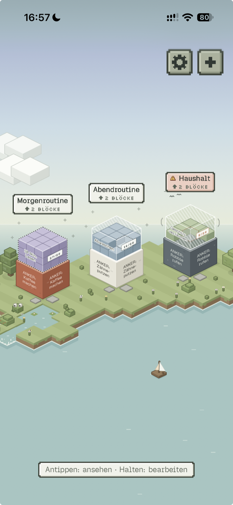

# Habit Stacks

**Gewohnheiten stapeln – Block für Block.**

Habit Stacks ist ein Habit-Tracker als Progressive Web App (PWA), aufgebaut auf dem Prinzip *Habit Stacking* von
James Clear („Nach [bestehender Gewohnheit] werde ich [neue Gewohnheit]“). Jede Routine ist ein isometrischer
Voxel-Turm auf einer kleinen Insel. Unten steht ein fester **Anker**, darauf stapelst du neue Gewohnheiten. Bleibst du
dran, wird ein Block fest. Lässt du ihn liegen, bröckelt er und fällt irgendwann vom Turm.

- **Local-First:** kein Konto, kein Tracking. Alle Daten bleiben auf deinem Gerät.
- **Offline nutzbar** und installierbar auf iPhone, Android und Desktop.
- **Optionale Push-Benachrichtigungen** über einen kleinen, selbst gehosteten PHP-Dienst ohne Abhängigkeiten.
- Oberfläche auf **Deutsch**.

## Ausprobieren

**Direkt im Browser: [habit-stacks.lukasweihrauch.de](https://habit-stacks.lukasweihrauch.de)**

Du musst nichts selbst hosten. Die öffentliche Instanz kannst du einfach öffnen, benutzen und als App installieren
(siehe [App installieren](#app-installieren-pwa)). Auch dort bleiben deine Türme nur auf deinem Gerät. Nur wenn du
Benachrichtigungen einschaltest, landet der Plan der geplanten Nachrichten auf dem Server
(siehe [Push-Benachrichtigungen](#push-benachrichtigungen)). Wer alles unter eigener Kontrolle haben möchte, kann die
App [selbst hosten](#selbst-hosten).

<p align="center">
  
</p>

---

## Inhalt

- [Ausprobieren](#ausprobieren)
- [Features](#features)
- [Spielregeln in Kürze](#spielregeln-in-kürze)
- [Tech-Stack](#tech-stack)
- [Selbst hosten](#selbst-hosten)
- [Push-Benachrichtigungen](#push-benachrichtigungen)
- [App installieren (PWA)](#app-installieren-pwa)
- [Was du sonst noch wissen solltest](#was-du-sonst-noch-wissen-solltest)
- [Entwicklung](#entwicklung)
- [Unterstützen & Links](#unterstützen--links)
- [Lizenz](#lizenz)

---

## Features

### Die Insel
- **Isometrische Voxel-Welt** mit Meer, Teich, Bach und Wasserfall, Bäumen, Blumen, Schmetterlingen und einem Frosch.
- **Jede Routine ist ein Turm.** Jeder Block besteht aus 27 Mini-Würfeln (3 × 3 × 3), ein Würfel pro erledigtem Tag.
- **Himmelsschichten:** Hohe Türme wachsen an Vögeln vorbei durch die Wolken bis zu den Sternen.
- **Zwei Ansichten:** Übersicht über alle Türme und Detailansicht für einen Turm mit Streak, Wochenleiste,
  Höhenlineal und dem nächsten offenen Block.
- **Sichtbarer Zustand:** Neue Blöcke („Geister“) sind halb durchsichtig und füllen sich Würfel für Würfel. Gefährdete
  Blöcke wackeln oder bröckeln, verlorene Blöcke landen auf einem Schutthaufen neben dem Turm.

### Fokus-Modus
- Arbeitet eine Routine **von unten nach oben** ab: abhaken oder mit **Timer** (1–120 Minuten).
- Die Kamera fährt am Turm hoch, der aktive Block leuchtet, erledigte Blöcke rasten ein.
- Der Timer läuft im Hintergrund und nach einem Neuladen weiter.
- Zum Schluss eine Zusammenfassung mit Kette, übersprungenen Blöcken und Streak.

### Neuigkeiten
- Beim Öffnen zeigt die App, was seit dem letzten Mal passiert ist (Block verfestigt, bröckelt, abgefallen, Turm
  eingestürzt …), jeweils mit Animation am Turm.
- Die App muss nicht täglich geöffnet werden. Verpasste Tage werden beim nächsten Start nachgeholt.

### Bauen & Bearbeiten
- Turm anlegen mit Name und Anker, Blöcke stapeln mit 9 Farben, Live-Vorschau und der Formel „Nach … werde ich …“.
- Blöcke umsortieren, abbauen, aus dem Schutthaufen neu stapeln, Türme verschieben, pausieren oder löschen.

### Benachrichtigungen (optional)
- Pro Turm eine **tägliche Erinnerung** (nur, wenn noch etwas offen ist) und **Warnungen**, bevor etwas verloren geht.
- Höchstens eine Nachricht pro Turm und Tag. Diagnose in den Einstellungen zeigt Server, Cronjob und letzte Fehler.

### Sonstiges
- **8-Bit-Töne** und synthetische **Naturgeräusche** (Wind, Brandung, Vögel, Grillen), beides abschaltbar.
- **Backup** als JSON exportieren und importieren.
- Respektiert „Bewegung reduzieren“, Tastaturbedienung und Screenreader-Texte.
- Jeder startet mit einer **leeren Insel** und baut seinen ersten Turm selbst.

---

## Spielregeln in Kürze

| Regel | Wert |
|---|---|
| Neuer Block wird fest nach | **28 erledigten Tagen**, sofort mit dem 28. Häkchen |
| Neuer Block bricht weg nach | **2 Tagen ohne Häkchen in Folge** („Nie zweimal verpassen“) |
| Neue Blöcke gleichzeitig pro Turm | **1** |
| Fester Block bröckelt nach | **2 Tagen ohne Häkchen in Folge** |
| Fester Block fällt ab nach | **4 Tagen ohne Häkchen in Folge** |
| Ganzer Turm 4 Tage ohne Häkchen | **Einsturz**: alles über dem Anker fällt, der Anker bleibt |
| Pausierter Turm | Es passiert **nichts**, bis du ihn fortsetzt |
| Gedächtnis-Bonus beim Neu-Stapeln | **18 von 28 Tagen** (für Blöcke, die schon einmal fest waren) |
| Neuer Tag beginnt um | **4:00 Uhr** (einstellbar 0–6 Uhr) |

**Merksatz:** Jeder Block zählt für sich. Ein Geist bricht nach 2 Tagen ohne Häkchen, ein fester Block fällt nach 4.

- **Anker:** der unterste Block, eine Gewohnheit, die du schon jeden Tag machst. Er bricht und fällt nie.
- **Geist:** ein neuer Block. Jeder erledigte Tag bringt einen Würfel. Ein einzelner Fehltag lässt ihn nur wackeln,
  zwei in Folge lassen ihn wegbrechen.
- **Fester Block:** Er braucht kein tägliches Häkchen, aber nach 2 Tagen ohne bröckelt er und nach 4 fällt er ab.
  Einmal erledigen genügt, dann steht er wieder sicher.
- **Heute ist immer offen.** Ausgewertet wird erst am nächsten Morgen. Vergangene Tage lassen sich nicht nachtragen.
- **Pausieren** (z. B. im Urlaub): Der Turm bekommt ein Schloss, nichts geht verloren, der Streak läuft weiter.
- **Schutthaufen:** Verlorene Blöcke lassen sich als Geist neu stapeln. Ihre Historie bleibt erhalten.
- **Streak:** aktive Tage am Stück mit mindestens einem erledigten Block. Reine Anzeige, pausierte Tage werden
  übersprungen.

Die Zahlen sind Standardwerte aus [src/domain/rules.ts](src/domain/rules.ts) und lassen sich dort ändern. Am
schnellsten probierst du die Regeln mit den DevTools aus (siehe [unten](#was-du-sonst-noch-wissen-solltest)).

---

## Tech-Stack

| Bereich | Technik |
|---|---|
| App | React 19, TypeScript, Vite 8, Tailwind CSS 4 |
| Zustand & Speicher | Zustand, IndexedDB (`idb-keyval`), Fallback `localStorage` |
| Animation | Framer Motion, eigenes Canvas-Rendering für die Insel |
| PWA | `vite-plugin-pwa` (Workbox, Manifest, Service Worker) |
| Tests | Vitest |
| Push-Dienst | PHP 8.0+ mit `openssl` und `curl`, ohne Bibliotheken |

---

## Selbst hosten

Optional: Zum Benutzen reicht die [öffentliche Instanz](https://habit-stacks.lukasweihrauch.de). Selbst hosten lohnt
sich, wenn du den Code anpassen oder den Push-Dienst auf deinem eigenen Server betreiben möchtest.

### Voraussetzungen

- **Node.js 22** (mindestens 20.19) und npm
- Ein Webserver mit **HTTPS**. Service Worker und Push funktionieren nur über HTTPS (Ausnahme: `localhost`).
- Für Push zusätzlich: **PHP 8.0+** mit den Erweiterungen `openssl` und `curl` sowie die Möglichkeit, einen
  **Cronjob** anzulegen

### 1. Lokal starten

```bash
git clone https://github.com/l2xu/habit-stacks.git
cd habit-stacks
npm install
npm run dev
```

Die App läuft dann unter <http://localhost:5173>. Im Dev-Server gibt es keinen Service Worker, Push ist dort deshalb
als „nicht unterstützt“ markiert. Zum Testen der PWA: `npm run build && npm run preview`.

### 2. Bauen

```bash
npm run build
```

Das Ergebnis liegt in `dist/`: statische Dateien plus der Push-Dienst unter `dist/push/`.

### 3. Deployen

Der Inhalt von `dist/` muss im **Stammverzeichnis einer (Sub-)Domain** liegen, also z. B. `https://habits.example.com/`
und nicht `https://example.com/habits/`. Manifest, Service Worker und Icons nutzen absolute Pfade ab `/`.

Zwei typische Wege:

- **Dateien hochladen:** `dist/` per SFTP, rsync o. Ä. in den Webroot kopieren.
- **Git-Deployment** (z. B. Plesk, eigener Server mit `git pull`): `dist/` ist absichtlich eingecheckt. Den
  Dokumentstamm der Domain auf den Ordner `dist/` im Repository zeigen lassen.

**Ohne Push** reicht jeder statische Host (z. B. Netlify, Cloudflare Pages oder ein eigener nginx). Die App
funktioniert dann vollständig, nur die Benachrichtigungen fehlen. Den Ordner `dist/push/` kannst du in dem Fall
löschen.

---

## Push-Benachrichtigungen

### Warum ein Server?

Browser können keine Benachrichtigung „morgen um 19 Uhr“ selbst planen. Web Push braucht immer einen Absender. Damit
trotzdem keine Gewohnheitsdaten das Gerät verlassen, ist die Arbeit geteilt:

```
App: planPushes() ──POST ?action=sync──► api.php ──► push/data/devices/<sha256(endpoint)>.php
                                                              │
Cronjob jede Minute ──► cron.php ── fällig? ──► Push-Dienst (Google / Apple / Mozilla)
                                                              │
                                     Service Worker (push-sw.js) ──► Nachricht auf dem Gerät
```

1. **Die App plant.** Bei jeder Änderung rechnet sie durch, was in den **nächsten 14 Tagen** passieren würde, wenn
   ab jetzt nichts mehr abgehakt wird: Wann bröckelt welcher Block, wann wackelt ein Geist, wann ist die tägliche
   Erinnerung fällig? Heraus kommt eine Liste mit festen Zeitpunkten, Titeln und Texten.
2. **Der Server speichert nur diesen Plan.** `api.php` legt pro Gerät das Push-Abo und die geplanten Nachrichten ab.
   Türme, Blöcke und Historie kennt der Server nicht.
3. **Ein Cronjob verschickt.** `cron.php` läuft jede Minute und schickt fällige Nachrichten über den Push-Dienst des
   Browsers (Google, Apple, Mozilla, Microsoft) an das Gerät. Verschlüsselung (RFC 8291) und VAPID (RFC 8292) sind
   direkt in PHP umgesetzt.
4. **Der Service Worker zeigt sie an.** Antippen öffnet die App.

Den **VAPID-Schlüssel** erzeugt der Dienst beim ersten Aufruf selbst. Du musst nichts konfigurieren.

### Einrichtung auf dem Server

1. **App deployen** wie oben beschrieben, sodass `https://deine-domain/push/api.php` erreichbar ist.
2. **PHP prüfen:** Version 8.0 oder neuer, Erweiterungen `openssl` und `curl` aktiv.
3. **Datenordner:** Der Dienst legt beim ersten Aufruf `push/data/` neben `lib.php` an (also `dist/push/data/`). PHP
   braucht dort Schreibrechte. Der Ordner ist in `.gitignore` und darf **nie** eingecheckt werden, weil er den
   privaten Schlüssel enthält.
4. **Cronjob anlegen**, der jede Minute läuft:

   ```cron
   * * * * * php /pfad/zum/webroot/push/cron.php
   ```

   Wichtig: Der Cronjob muss unter **demselben Benutzer** laufen wie PHP auf dem Webserver. Sonst gehören die Dateien
   in `push/data/` dem falschen Benutzer und `api.php` oder `cron.php` kann sie nicht lesen.

   **Plesk:** Geplante Aufgaben → Aufgabe hinzufügen → „PHP-Skript ausführen“ →
   `<Deploy-Ordner>/dist/push/cron.php`, Zeitplan im Cron-Stil `* * * * *`, Benachrichtigung „nur bei Fehlern“.
5. **Testen:** In der App unter Einstellungen → Benachrichtigungen → **Anmelden** → **Test-Nachricht**. Die Diagnose
   darüber zeigt, ob der Server erreichbar ist, wann der Cronjob zuletzt lief und den letzten Fehler im Klartext.
6. **Pro Turm einschalten:** Turm gedrückt halten → Benachrichtigungen → Erinnerung und/oder Warnung plus Uhrzeit.

### Absicherung des Datenordners

Jede Datei in `push/data/` beginnt mit `<?php exit; ?>`. Ruft jemand sie im Browser auf, kommt nichts zurück.
Zusätzlich sperren `.htaccess`-Dateien den Datenordner sowie `lib.php` und `cron.php`.

**`.htaccess` wirkt nur unter Apache** (mit `AllowOverride`). Unter **nginx** brauchst du eigene Regeln:

```nginx
location ^~ /push/data/ { deny all; }
location ~ ^/push/(lib|cron)\.php$ { deny all; }
```

Wer den Datenordner lieber außerhalb des Webroots hat, setzt die Umgebungsvariable `HABIT_PUSH_DATA` auf einen
anderen Pfad, und zwar **sowohl für PHP im Webserver als auch für den Cronjob**. Auf Shared Hosting (z. B. Plesk mit
`open_basedir`) klappt das oft nicht, deshalb liegt der Ordner standardmäßig im Webroot.

### Grenzen

- Der Dienst ist für den **privaten Gebrauch** gedacht: höchstens 50 Geräte und 500 geplante Nachrichten pro Gerät
  (`PUSH_MAX_DEVICES` und `PUSH_MAX_ITEMS` in [public/push/lib.php](public/push/lib.php)).
- `api.php` nimmt nur Anfragen von **derselben Domain** an. App und Push-Dienst müssen also auf demselben Host laufen.
- Der Plan reicht **14 Tage** weit. Wer die App länger nicht öffnet, bekommt danach keine Nachrichten mehr.
- Wer **offline** abhakt, bekommt eventuell eine überflüssige Warnung, bis die App wieder online ist und den neuen
  Plan geschickt hat.
- Verpasst der Cronjob eine Nachricht um mehr als 15 Minuten, verfällt sie.
- Löschst du den VAPID-Schlüssel (`push/data/vapid.php`), melden sich alle Geräte beim nächsten Öffnen der App neu an.

### Push lokal testen

```bash
npm run push:dev                      # PHP-Server auf Port 8787, Daten in ./push-data
npm run build && npm run preview      # App mit Service Worker, /push/ wird an PHP weitergeleitet
npm run push:cron                     # fällige Nachrichten einmalig verschicken
```

Am einfachsten geht das mit Chrome oder Edge auf dem Desktop, weil `localhost` als sicherer Ursprung gilt.

---

## App installieren (PWA)

Habit Stacks ist eine Web-App, die sich wie eine normale App auf den Home-Bildschirm legen lässt. Danach startet sie
im Vollbild, funktioniert offline und aktualisiert sich selbst.

### iPhone & iPad

1. Die Adresse der App in **Safari** öffnen (ab iOS 16.4 geht das auch aus anderen Browsern über deren Teilen-Menü).
2. Auf **Teilen** tippen (Quadrat mit Pfeil nach oben).
3. **„Zum Home-Bildschirm“** wählen. Falls angeboten, „Als Web-App öffnen“ eingeschaltet lassen.
4. **Hinzufügen** tippen und die App ab jetzt **über das Icon** auf dem Home-Bildschirm öffnen.

Wichtig auf iOS:

- **Push gibt es nur in der installierten App** (ab iOS 16.4), nicht im Safari-Tab.
- Die installierte App hat **eigenen Speicher, getrennt von Safari.** Hast du die App vorher im Browser benutzt, sind
  die Daten nach der Installation nicht automatisch da. Vorher in Safari unter Einstellungen → Daten & Backup ein **Backup
  exportieren** und in der installierten App wieder **importieren**.
- Safari löscht Daten von Websites, die länger nicht besucht wurden. Installierte Web-Apps sind davon nicht betroffen.
  Auch deshalb lohnt sich die Installation.

### Android

**Chrome:**
1. Die Adresse der App öffnen.
2. Menü **⋮** → **„App installieren“** (oder „Zum Startbildschirm hinzufügen“). Oft erscheint auch direkt ein
   Installationshinweis.
3. **Installieren** bestätigen.

**Samsung Internet:** Menü → „Seite hinzufügen zu“ → „Startbildschirm“.
**Firefox:** Menü → „Installieren“ bzw. „Zum Startbildschirm hinzufügen“.

Push funktioniert auf Android auch ohne Installation im Browser. Installiert ist es trotzdem angenehmer.

### Desktop

- **Chrome / Edge:** Installationssymbol rechts in der Adressleiste oder Menü → „App installieren“.
- **Safari (macOS Sonoma und neuer):** Ablage → „Zum Dock hinzufügen“.

### Updates

Neue Versionen lädt die App im Hintergrund. Spätestens nach dem vollständigen Schließen und erneuten Öffnen läuft die
neue Version. Version und Build-Zeit stehen ganz unten in den Einstellungen.

---

## Was du sonst noch wissen solltest

- **Deine Daten liegen nur auf dem Gerät.** Es gibt keine Synchronisation zwischen Geräten. Wer Browserdaten löscht
  oder die App deinstalliert, verliert die Türme. Exportiere deshalb regelmäßig ein **Backup** (Einstellungen →
  Daten & Backup).
- **Ein Gerät, eine Insel.** Möchtest du das Gerät wechseln: Backup exportieren und auf dem neuen Gerät importieren.
  Danach dort Push neu anmelden.
- **Daten sind geschützt.** Beschädigte Daten oder Daten aus einer neueren App-Version werden nie überschrieben. Die
  App zeigt dann einen Fehler und arbeitet nur im Speicher.
- **Der Tag beginnt um 4 Uhr.** Wer um 1 Uhr nachts abhakt, zählt noch zum Vortag. Einstellbar zwischen 0 und 6 Uhr.
- **DevTools:** Der gelbe **DEV**-Knopf in der Kopfzeile ist vorübergehend auch im Build enthalten. Damit lässt sich
  die Zeit vorspulen und jeder Block manipulieren, gut zum Ausprobieren der Regeln. Er betrifft nur die lokalen Daten.
- **Für Forks:** Unter Einstellungen → „Meine Links“ stehen die Links des ursprünglichen Autors
  ([src/features/settings/SettingsPanel.tsx](src/features/settings/SettingsPanel.tsx)). Passe sie für deine eigene
  Instanz an.
- **`dist/` ist eingecheckt**, damit ein Server per Git deployen kann. Nach Änderungen am Code also neu bauen.
  `npm run release` testet, baut, committet **alle** Änderungen (`git add -A`) und pusht. Prüfe vorher, dass keine
  ungewollten Dateien im Arbeitsverzeichnis liegen.
- **Statischer Host ohne PHP:** Die Dateien unter `dist/push/` würden dort als Text ausgeliefert. Sie enthalten keine
  Geheimnisse (der Schlüssel entsteht erst auf dem Server), sind aber nutzlos. Löschen schadet nicht.

---

## Entwicklung

| Befehl | Zweck |
|---|---|
| `npm run dev` | Entwicklungsserver |
| `npm run build` | Typecheck und Produktions-Build nach `dist/` |
| `npm run preview` | Build lokal ausliefern (mit Service Worker) |
| `npm test` | Tests einmal ausführen |
| `npm run test:watch` | Tests im Watch-Modus |
| `npm run typecheck` | Nur TypeScript prüfen |
| `npm run push:dev` | Lokaler PHP-Server für den Push-Dienst (Port 8787) |
| `npm run push:cron` | Fällige Push-Nachrichten lokal verschicken |
| `npm run release` | Testen, bauen, committen und pushen (optional mit Notiz: `npm run release -- "Notiz"`) |
| `node scripts/generate-icons.mjs` | Favicon aus dem Pixel-Raster erzeugen |
| `node scripts/generate-app-icons.mjs` | App-Icons rendern (braucht ein lokales Chrome) |

### Projektstruktur

```
src/
  domain/      Spielregeln und Engine (reine Funktionen, gut getestet)
  store/       Zustand-Store, Speichern, Backup
  features/    Bildschirme und Bereiche: home, world, focus, editor, news, notify, settings, dev …
  ui/          Wiederverwendbare Pixel-UI-Bausteine
  hooks/, lib/ Hilfsfunktionen (Audio, Ambience, Safe-Areas …)
public/
  push/        Push-Dienst (PHP)
  push-sw.js   Push-Teil des Service Workers
scripts/       Icons und Release
```

Die Regeln liegen bewusst getrennt von der Darstellung in `src/domain/`. Wer an den Regeln dreht, fängt bei
[src/domain/rules.ts](src/domain/rules.ts) und [src/domain/engine.ts](src/domain/engine.ts) an.

---

## Unterstützen & Links

Dir gefällt Habit Stacks? Über einen Kaffee freue ich mich sehr:

[](https://ko-fi.com/lukasweihrauch)

- **Ko-fi:** [ko-fi.com/lukasweihrauch](https://ko-fi.com/lukasweihrauch)
- **YouTube:** [@Lukas_Weihrauch](https://www.youtube.com/@Lukas_Weihrauch/)
- **Webseite:** [lukasweihrauch.de](https://lukasweihrauch.de/)

---

## Lizenz

[MIT](LICENSE) © 2026 Lukas Weihrauch
